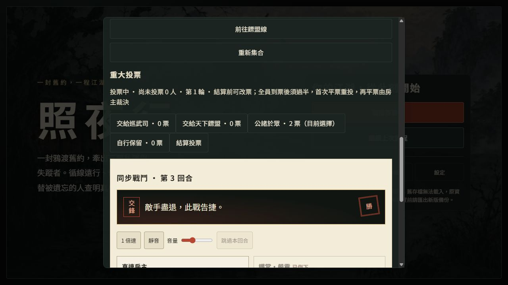
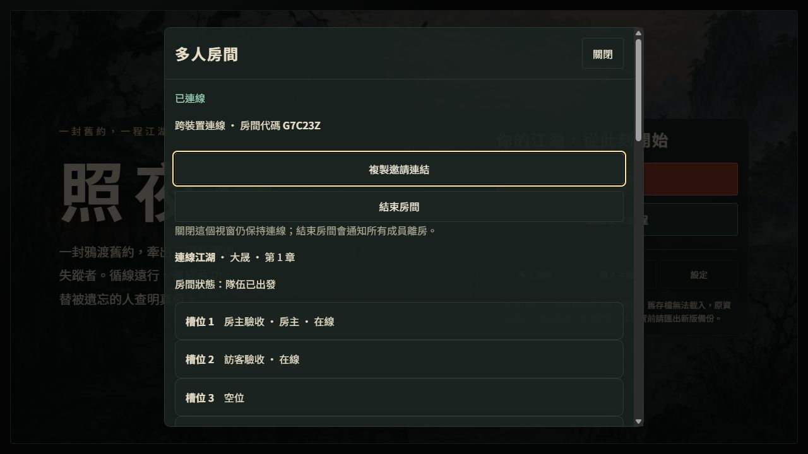

# 跨裝置連線與驗收

版本 0.6.1；實作日期 2026-11-14。預設使用 PeerJS／WebRTC（協定 3），保留 Node WebSocket 服務（協定 2）及同機測試模式。單人存檔維持格式 4／故事修訂 2。

## 預設：PeerJS／WebRTC

直接開啟 [遊戲](https://yuiban76.github.io/7414/)，不必申請帳號、填伺服器網址或另架常駐主機：

1. 選「多人房間」→「WebRTC 直連（免自架主機）」，輸入名字並建立房間。
2. 將邀請連結或六碼房號交給朋友。朋友輸入名字後加入，最多四人。
3. 全員準備，房主開始，即可聊天、分隊、投票與同步演武。
4. 保持房主分頁開啟。關閉房間視窗仍維持連線，按「結束房間」才通知全員離房。

PeerServer Cloud 免費提供接應，遊戲指令及狀態經 WebRTC DataChannel 傳輸，不經自架遊戲伺服器。網站隨附 PeerJS 1.5.5 及 MIT 授權，不依賴外部 CDN。沒有建立 Render 服務、購買主機或啟用付費方案。官方共享服務可能受限或中斷，沒有可用性保證；部分 NAT／防火牆可能需要更換網路或額外 TURN。SDK 使用官方預設 ICE 設定，若需自有服務，可由 `PeerRoomClient` 的 `peerOptions` 設定；本次未提供 TURN 帳號管理介面。

房主是此模式的權威節點，核對玩家身分與命令，產生固定戰鬥與投票內容，並向其他人廣播狀態。這可防止訪客偽造他人操作或自行改寫戰果，但不能防止房主修改自己的程式。接應 ID 及房號只負責尋房；重連另用隨機憑證核對。房主快照只存訪客憑證雜湊，憑證不放邀請連結或房間廣播。

訪客暫時失聯會自動退避重連，最長一分鐘。房主或訪客重整後可按「重連上次房間」續接同一回合；房主快照存於該分頁 sessionStorage，整個分頁關閉後不保證能恢復。房主不在時訪客不能繼續結算，沒有自動換房主，逾時需重開房間。離房與關閉房間清除本分頁重連資料，單人正式存檔不受影響。

## 備用：Node WebSocket 服務

下列步驟只適用「伺服器連線（需服務網址）」。預設 WebRTC 模式無須執行 `npm start`、部署 Docker 或 Render。尚未開設公開常駐 WebSocket 主機。

## 本機啟動

使用 Node 24。在倉庫根目錄執行：

```sh
npm ci --ignore-scripts
npm run serve
```

另開終端：

```sh
npm start
```

遊戲：`http://127.0.0.1:4173`；服務：`ws://127.0.0.1:8787/rooms`；健康檢查：`http://127.0.0.1:8787/healthz`。

1. 在「多人房間」選「伺服器連線（需服務網址）」，填入服務網址與名字，建立房間。
2. 朋友開啟邀請連結，或在自己的遊戲輸入相同服務與六碼房號。
3. 全員準備後由房主開始，可聊天、分隊、發起本章投票及同步演武。
4. 每位玩家提交本回合行動後，房主請求伺服器結算；客戶端無法自行提交戰果、敵人氣血或他人的行動。
5. 關閉房間視窗仍保持連線；離房按鈕才退出。房主結束房間會通知全體成員。

若兩台裝置在同一區域網路：以主機 LAN 位址取代 `127.0.0.1`，並將前端來源（例如 `http://192.168.1.10:4173`）加入 `ALLOWED_ORIGINS`。本機 IP 代表各裝置自己，朋友不可填房主電腦上的 localhost。不要直接將開發用靜態伺服器曝露到公網。

## 公開部署

前端仍放 GitHub Pages；連線服務是獨立的 Node 程序。部署成功後，在遊戲的服務網址欄填入 HTTPS 網址，會自動使用 WSS 的 `/rooms`，邀請連結也會附帶服務地址及房號。若要為所有玩家預設同一服務，設定 `src/config/network.js` 的 `ROOM_SERVER_URL` 後再發布前端。

### Node 主機／Render

倉庫提供 `render.yaml` 範本。使用支援 WebSocket 的 Node Web Service：

- 建置：`npm ci --omit=dev --ignore-scripts`
- 啟動：`node server/main.mjs`
- 健康檢查：`/healthz`
- `PORT`：採主機提供的連接埠。
- `ALLOWED_ORIGINS`：`https://yuiban76.github.io`，多個來源以逗號分隔，只寫來源，不加 `/7414/` 路徑。
- 公網一律使用 HTTPS／WSS，TLS 可由代管平台或反向代理終止。

範本使用免費方案及記憶體房間，適合測試，不包含持久磁碟。免費服務閒置後可能休眠，首次喚醒約需一分鐘；遊戲初次連線會自動重試最多 75 秒，期間可取消，逾時後可再次加入。休眠、部署或程序重啟後，沒有持久儲存的房間需重開；若需要重啟恢復，掛載持久磁碟並設定 `ROOM_DATA_DIR`。啟用服務前請自行確認主機供應商的方案、費用及閒置規則；本次沒有建立帳號、購買主機或啟用付費服務。

### Docker

```sh
docker build -t zhaoye-rooms .
docker run --rm -p 8787:8787 -v zhaoye-rooms:/data -e ALLOWED_ORIGINS=https://yuiban76.github.io zhaoye-rooms
```

容器以非 root 的 node 使用者執行，房間資料位於 `/data/rooms`。公網前須另設 HTTPS／WSS 反向代理；不要把房間資料目錄交由靜態網站伺服器公開。

此服務目前採單程序／單副本；不要水平擴充為多副本，否則不同成員可能連到不同的房間記憶體。未接入 Redis、資料庫叢集或跨區域一致性。

## 連線、身分與重連

- 房號由加密安全亂數生成；最多四人，隊伍出發後只接受原成員重連。
- 伺服器核發玩家 ID 與 256-bit 重連憑證。憑證只經 WebSocket 訊息傳送，存在本分頁 sessionStorage；不放網址、邀請連結或廣播狀態。磁碟僅保存憑證雜湊。
- 斷線後自動退避重試，最長 60 秒；按鈕暫停操作。頁面重整可透過「重連上次房間」恢復原身分與回合。
- 同一憑證在另一分頁恢復會關閉舊連線，避免兩個分頁互相搶回連線。
- 房主斷線會暫停世界操作；逾時即結束房間，不擅自更換房主。
- 訪客斷線後暫留投票／戰鬥席位；60 秒後投票只計在線成員，戰鬥缺席者採防禦，避免卡死。離房則立即移出席位。
- 心跳清除失效連線；限制來源、訊息大小、訊息速率、房間數與連線數。未知協定、不合法 payload、偽造身分／狀態與過期戰鬥或投票上下文均拒絕。
- 已處理指令保存去重回執；連線中斷遺失回覆時，以相同指令 ID 重新查收，不重算戰果。戰鬥還額外核對實例與回合。
- 房間六小時沒有有效操作後清除。大廳中逾時斷線者會釋出槽位。

`ROOM_DATA_DIR` 選配逐房快照，先寫暫存檔再更名；包含房間狀態、回執及雜湊憑證。重啟載入後先把舊連線標為斷線，再由原憑證恢復。匿名房間不是帳號登入，也不能拿房間狀態改寫單人正式存檔。

## 範圍

兩種跨裝置模式均支援連線大廳、聊天、分隊標記、房間投票及共同演武；投票與演武採固定章節資料，結果留在房間。WebRTC 由房主結算，WebSocket 由服務結算。八章主線／十二支線的合作推進、角色成長與跨裝置永久世界存檔尚未接入。

## 驗證

```sh
npm test
npm run test:network
npm run test:peer
npm run validate
```

最終完整測試 **203 項通過**，包含 13 項真實 WebSocket 網路／設定測試、一項既有同機模式離房回歸與七項 PeerJS 協定測試。內容驗證與語法檢查亦通過。

PeerJS 自動測試使用模擬 DataChannel，覆蓋四人同步、固定戰鬥與投票、滿房、偽造身分、過期回合、重複操作、憑證雜湊、訪客自動重連、房主快照恢復、遺失回覆重送及離房通知。這些測試不模擬真實 ICE／NAT 穿透。

另以兩個真實瀏覽器頁面，分別從 `127.0.0.1` 與 `localhost` 連接官方 PeerServer Cloud，成功建立 WebRTC 房間；測試雙人準備、聊天、三回合同步演武至勝利、雙人投票結算、房主重整後訪客自動重連、訪客重整後原身分續接及房主結束通知。過程只啟動靜態網頁預覽，未啟動 Node WebSocket 服務。本機雙來源測試確認實際 PeerJS 路徑，尚未實測兩支手機跨行動網路或所有 NAT 組合。



整合測試使用真正 HTTP／WebSocket 服務及四個獨立客戶端，覆蓋四人同步、滿房／出發拒絕、身分偽造、錯誤協定、來源限制、原型污染、重複指令、過期回合、遺失回覆後重送、原身分重連、重連截止、房主暫停／離房、訪客斷線防卡及磁碟重啟恢復。測試會啟動 loopback 服務，在限制網路的工作環境需允許本機測試連線。

實際瀏覽器以 `127.0.0.1` 與 `localhost` 兩個不同來源連至同一服務，測試大廳、準備、聊天、演武及房主重整恢復。不同來源不能使用同一個 BroadcastChannel，因此此走查確認了遠端傳輸路徑。Docker 建置及公開主機部署尚未執行。





部署參考：[PeerJS 快速入門](https://peerjs.com/client/getting-started)、[PeerServer Cloud](https://peerjs.com/server/cloud)、[PeerJS 免費服務及 NAT 說明](https://peerjs.com/client/faq)、[ws 官方說明](https://github.com/websockets/ws)、[Render WebSocket 文件](https://render.com/docs/websocket)、[Render 免費方案限制](https://render.com/docs/free)、[Blueprint 欄位規格](https://render.com/docs/blueprint-spec)。
